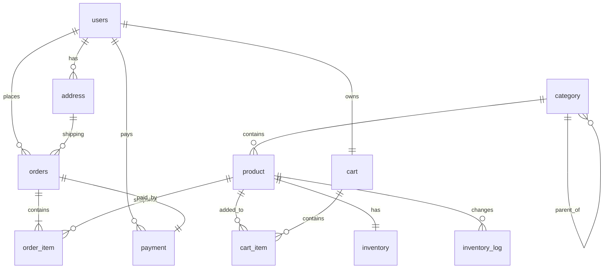

# 电商订单管理系统——数据库设计（初稿）

> 项目：**电商订单管理系统**（给定方案一）  
> 课程：2026 年《数据库系统原理》课程设计  
> 组号：第 X 组  
> 生成日期：2026-11-08  
> 本文件由 `scripts/build_docs.py` 从 `scripts/data.py` 生成，请勿手改。

> 阶段说明：本文件是立项阶段的初步设计，用于统一表名、字段范围和业务约束；完整字段类型、DDL、ER 图和数据样例将在第 11 周细化。

## 1. 设计原则

- 使用 MySQL 8.0、InnoDB、utf8mb4；金额统一 `DECIMAL(10,2)`，时间统一 `DATETIME`。
- 主键统一 `BIGINT UNSIGNED AUTO_INCREMENT`；业务单号（订单号、支付号）单独建唯一索引。
- 主数据（用户、分类、商品）采用状态字段做逻辑删除，避免破坏历史订单引用。
- 订单明细保存商品名称、下单单价、数量和小计快照，商品调价不影响历史订单。
- 库存变动必须写 `inventory_log`，保证可追溯；库存扣减与回补必须在事务内完成。
- 表名使用小写复数或业务名，字段名使用 snake_case。

## 2. 实体关系（Mermaid 初稿）



> 说明：`payment.order_id` 唯一，用于支付幂等；`cart.user_id` 唯一，保证一个用户一个购物车；`inventory.product_id` 唯一，保证一个商品一条库存记录。

## 3. 表清单

| 序号 | 表名 | 中文名 | 关键字段 | 作用 |
|---|---|---|---|---|
| 1 | users | 用户表 | user_id、username、password_hash、phone、email、role、status、created_at | 账号、角色与状态 |
| 2 | address | 收货地址表 | address_id、user_id、receiver、phone、province、city、district、detail、is_default | 用户收货地址 |
| 3 | category | 商品分类表 | category_id、name、parent_id、sort_no、status | 分类树与排序 |
| 4 | product | 商品表 | product_id、category_id、name、price、original_price、description、image_url、status、created_at | 商品主数据 |
| 5 | inventory | 库存表 | inventory_id、product_id、stock、warning_threshold、updated_at | 可售库存与预警 |
| 6 | inventory_log | 库存流水表 | log_id、product_id、change_qty、before_stock、after_stock、change_type、order_id、operator_id、remark、created_at | 库存变动审计 |
| 7 | cart | 购物车表 | cart_id、user_id、created_at | 用户唯一购物车 |
| 8 | cart_item | 购物车明细表 | cart_item_id、cart_id、product_id、quantity、selected、added_at | 购物车商品明细 |
| 9 | orders | 订单表 | order_id、order_no、user_id、address_id、total_amount、status、remark、idempotency_key、created_at、paid_at、shipped_at、completed_at、cancelled_at | 订单主表与状态时间 |
| 10 | order_item | 订单明细表 | order_item_id、order_id、product_id、product_name、unit_price、quantity、subtotal | 下单时价格快照 |
| 11 | payment | 支付记录表 | payment_id、payment_no、order_id、user_id、amount、method、status、paid_at | 支付流水与幂等 |

## 4. 关键约束

| 表 | 约束 / 索引 | 说明 |
|---|---|---|
| users | UNIQUE(username), UNIQUE(phone) | 用户名、手机号唯一；role、status 使用枚举/短字符串并在服务层校验。 |
| address | FK(user_id), INDEX(user_id, is_default) | 同一用户默认地址由事务保证唯一；删除前检查未完成订单引用。 |
| category | UNIQUE(name), FK(parent_id) | 分类名唯一；存在子分类或商品时禁止删除。 |
| product | FK(category_id), CHECK(price >= 0) | 仅上架商品可购买；被订单引用时只下架不物理删除。 |
| inventory | UNIQUE(product_id), CHECK(stock >= 0) | 一商品一库存；低库存条件为 stock <= warning_threshold。 |
| inventory_log | FK(product_id), CHECK(change_qty <> 0) | 只增不改；记录 before_stock / after_stock 与 change_type。 |
| cart | UNIQUE(user_id) | 一个用户一个购物车。 |
| cart_item | UNIQUE(cart_id, product_id), CHECK(quantity > 0) | 重复加购累加数量；勾选状态 selected 为 0/1。 |
| orders | UNIQUE(order_no), UNIQUE(idempotency_key), CHECK(total_amount >= 0) | 订单号与幂等键唯一；状态机集中校验。 |
| order_item | FK(order_id), FK(product_id), CHECK(quantity > 0), CHECK(unit_price >= 0) | 保存商品名称、单价、数量、小计快照。 |
| payment | UNIQUE(order_id), CHECK(amount >= 0) | 订单最多一条成功支付记录；重复支付返回已有结果。 |

## 5. 索引规划

| 索引 | 列 | 用途 |
|---|---|---|
| idx_orders_user_time | orders(user_id, created_at) | 用户订单列表按时间倒序分页。 |
| idx_orders_status_time | orders(status, created_at) | 后台按状态筛选与履约看板。 |
| idx_product_category_status | product(category_id, status) | 分类页与上架商品检索。 |
| idx_order_item_order | order_item(order_id) | 订单详情与销量聚合。 |
| idx_inventory_stock | inventory(stock) | 低库存扫描与预警。 |
| uk_payment_order | payment(order_id) UNIQUE | 支付幂等与订单支付查询。 |
| uk_cart_item | cart_item(cart_id, product_id) UNIQUE | 重复加购合并。 |

## 6. 状态与枚举

| 字段 | 建议取值 | 说明 |
|---|---|---|
| users.role | USER / ADMIN | 普通用户 / 管理员。 |
| users.status | 0 / 1 | 禁用 / 正常；禁用用户不能登录和下单。 |
| product.status | 0 / 1 / 2 | 下架 / 上架 / 已删除（逻辑删除）。 |
| orders.status | UNPAID / PAID / SHIPPED / COMPLETED / CANCELLED | 待支付 / 已支付 / 已发货 / 已完成 / 已取消。 |
| payment.status | PENDING / SUCCESS / FAILED | 待支付 / 支付成功 / 支付失败；退款暂不实现。 |
| inventory_log.change_type | PURCHASE_IN / ORDER_OUT / CANCEL_IN / ADJUST | 采购入库 / 下单出库 / 取消回补 / 盘点调整。 |
| cart_item.selected | 0 / 1 | 未勾选 / 已勾选。 |
| address.is_default | 0 / 1 | 非默认 / 默认。 |

## 7. 事务与并发设计

### 7.1 下单扣库存

```sql
START TRANSACTION;
-- 1. 按 product_id 升序锁定库存行，避免死锁
SELECT stock FROM inventory WHERE product_id = ? FOR UPDATE;
-- 2. 校验库存；不足则 ROLLBACK 并返回具体商品
-- 3. 写 orders、order_item
-- 4. UPDATE inventory SET stock = stock - ? WHERE product_id = ?;
-- 5. 写 inventory_log（ORDER_OUT）
-- 6. 删除已结算的 cart_item
COMMIT;
```

### 7.2 取消回补

- 仅允许 `UNPAID → CANCELLED`；事务内更新订单状态、回补 `inventory.stock`、写 `inventory_log`（CANCEL_IN）。
- 若订单已支付，取消需要退款流程；本期不实现，返回“已支付订单请联系管理员”。

### 7.3 支付幂等

- `payment.order_id` 唯一；重复支付请求先查已有成功记录，存在则直接返回。
- 支付状态与订单状态在同一事务内更新；失败支付保留 FAILED 记录用于排查。

### 7.4 重复提交

- 下单请求携带 `idempotency_key`；`orders.idempotency_key` 唯一。
- 重复请求返回同一订单，不重复扣库存。

## 8. 待细化事项

- [ ] 完整字段类型、长度、默认值、注释。
- [ ] 完整 ER 图（Chen 表示法或 Crow's Foot）。
- [ ] 建表 DDL 与初始化数据（用户、分类、商品、库存、样例订单）。
- [ ] 外键删除策略（RESTRICT / CASCADE）逐表确认。
- [ ] 订单状态机时序图与异常测试用例。
